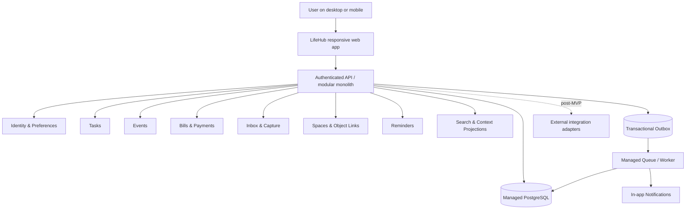
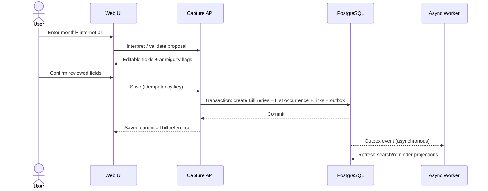
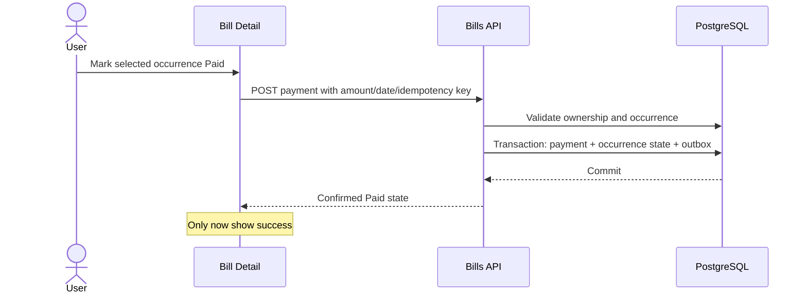

# LifeHub — Architecture Specification v1.0

> **Status:** Proposed / review required · 2026-10-20  
> **Scope:** Conceptual technical architecture only. **No application code.**  
> **Baseline:** Product Vision, IA v1.0, Wireframes v1.1, Interaction v1.2, High-Fidelity v1.3, UI Polish v1.4.  
> **North star:** Capture once. Stay in context. Act anywhere.

## 1. Architectural decisions

| ID | Decision | Rationale |
|---|---|---|
| ADR-01 | Managed-cloud modular monolith | MVP operational simplicity with explicit module boundaries |
| ADR-02 | Responsive web, PWA-ready | Shared desktop/mobile UX |
| ADR-03 | Managed PostgreSQL as system of record | ACID writes, relational integrity, flexible indexing |
| ADR-04 | Managed identity provider | Avoid bespoke password/session security |
| ADR-05 | API application with domain modules | Clear authorization, validation and transactional boundaries |
| ADR-06 | Outbox + managed queue/worker for async jobs | Reliable reminder scheduling and projections |
| ADR-07 | PostgreSQL full-text initially | Avoid separate search cluster |
| ADR-08 | Native objects have a single owner; views are projections | No duplication between Today, Upcoming and Spaces |
| ADR-09 | Optional external integration adapters after MVP | Reduce initial scope and protect ownership |
| ADR-10 | Explicit confirmation for capture interpretation | Avoid silent errors for bills and dates |

Cloud vendor, framework, exact queue, cost target, and delivery provider remain open.

## 2. Context diagram



Today and Upcoming are read compositions, **not** additional object-owning modules. UI never directly queries another user's database records.

## 3. Domain boundaries

| Domain | Owns | Responsibilities |
|---|---|---|
| Identity | User, UserPreferences | auth mapping, timezone, locale |
| Tasks | Task | title, status, due date, priority |
| Events | EventSeries, EventOccurrenceOverride | time, timezone, recurrence |
| Bills | BillSeries, BillOccurrence, Payment | obligation, due date, payment history |
| Inbox | CaptureItem | unprocessed user input, conversion state |
| Spaces | Space, SpaceMembership | context grouping, not record ownership |
| Relations | ObjectLink | typed, tenant-safe cross-domain links |
| Reminders | ReminderRule, NotificationDelivery | scheduling, deduplication |
| Search | SearchDocument | indexed cross-domain discovery |
| Today/Upcoming | No canonical business records | aggregated contextual read models |
| Audit | AuditEvent | sensitive state change trace |

Domain modules own writes. Cross-module reads occur through explicit application services / query projections, not direct UI duplication.

## 4. Conceptual schema

All user-owned tables carry `user_id`, `created_at`, `updated_at`; UUID/ULID-style stable IDs are recommended. All timestamps stored in UTC with IANA timezone for scheduling.

| Entity | Key conceptual fields |
|---|---|
| User | id, auth_subject, status |
| UserPreferences | user_id, locale=id-ID, timezone=Asia/Jakarta default suggestion, week_start, notification_settings |
| Task | id, user_id, title, description?, status(open/done), due_at?, priority?, completed_at?, version |
| EventSeries | id, user_id, title, start_local, end_local, timezone, recurrence_rule?, status |
| EventOccurrenceOverride | id, series_id, occurrence_key, start_override?, end_override?, cancelled, version |
| BillSeries | id, user_id, title, amount_minor, currency=IDR, recurrence_rule?, timezone, due_day, active |
| BillOccurrence | id, series_id, occurrence_key, due_at, amount_minor, status, version |
| Payment | id, occurrence_id, amount_minor, paid_at, created_by, idempotency_key |
| CaptureItem | id, user_id, raw_text, classification?, state(unprocessed/converted/archived), converted_object_ref?, version |
| Space | id, user_id, name, is_default |
| SpaceMembership | user_id, space_id, object_type, object_id |
| ObjectLink | id, user_id, source_type/id, target_type/id, relation_type, created_at |
| ReminderRule | id, user_id, target_type/id, trigger_spec, timezone, enabled |
| NotificationDelivery | id, user_id, reminder_id, occurrence_key, channel, state, delivered_at? |
| SearchDocument | user_id, object_type, object_id, title, searchable_text, updated_at |
| OutboxEvent | id, event_type, aggregate_ref, payload, created_at, published_at? |
| AuditEvent | id, user_id, action, object_ref, timestamp, metadata (redacted) |

**Invariants:**
1. Every object reference must resolve to an object accessible to the same user (enforced in application authorization; not assumed from polymorphic IDs).
2. A unique constraint prevents duplicate BillOccurrence for (series_id, occurrence_key).
3. Payment idempotency key unique per user/action; repeated requests return the original result.
4. A unique delivery key (reminder_id, occurrence_key, channel) prevents duplicate notifications.
5. Money uses integer minor units (for IDR, rupiah units can be modeled explicitly), never binary floating point.
6. No cross-user object links or memberships.
7. Historical paid occurrences remain immutable or corrected through audited adjustments, not silently overwritten by series edits.
8. Deleting Space removes memberships, **not** Task/Event/Bill objects.
9. Conversion from Inbox is atomic: create target + link origin + mark converted in one transaction.
10. Due/overdue is computed from date/time and payment state; never a second independent source of truth.

### Recurrence policy (requires product confirmation)
For monthly dates 29–31, proposed default is **last valid day of shorter month**, with rule shown to the user before save. Occurrence key is stable across schedule edits. Editing 'this and future' may split a series while preserving old occurrence history.

## 5. API boundaries (conceptual, not finalized REST contract)

All endpoints authenticated; resource ownership and authorization checked server-side. Pagination, input validation, request IDs, structured error codes and rate limits required.

| Boundary | Example operations |
|---|---|
| `/v1/me` | read/update preferences |
| `/v1/today` | contextual action feed |
| `/v1/upcoming` | date-range timeline + filters |
| `/v1/tasks` | create/list/update/complete/reopen |
| `/v1/events` | create/read/update recurrence scope |
| `/v1/bills` | create/read/update series |
| `/v1/bills/{id}/occurrences` | list occurrence state |
| `/v1/bill-occurrences/{id}/payments` | record payment with idempotency key |
| `/v1/inbox` | capture, triage, convert |
| `/v1/spaces` | manage contexts and memberships |
| `/v1/object-links` | link/unlink authorized objects |
| `/v1/search` | cross-domain query |
| `/v1/reminders` | configure rules, list notifications |

**Read boundary:** Today and Upcoming return references and display metadata to canonical objects, not independently editable copies.  
**Write boundary:** commands go to owning domain. Concurrency via object version/ETag or equivalent.  
**Capture boundary:** natural-language interpretation returns a *proposal*; saving requires explicit reviewed fields. No dependency on LLM for MVP.

## 6. Critical sequences

### Quick Capture → recurring Bill


### Mark Bill occurrence as Paid


### Inbox conversion
```mermaid
sequenceDiagram
    actor User
    participant UI as Inbox
    participant API as Capture API
    participant DB as PostgreSQL
    User->>UI: Convert item to Task
    UI->>API: Get editable review
    User->>UI: Confirm Task
    UI->>API: Convert with idempotency key
    API->>DB: Atomic target create + origin link + mark converted
    DB-->>API: Commit
    API-->>UI: Target URL; remove item from active Inbox
```

## 7. Data synchronization & consistency

- **Strong consistency:** writes to a domain aggregate, payment/occurrence, Inbox conversion and same-transaction outbox record.
- **Eventual consistency:** SearchDocument, reminder jobs, optional cached Today projections.
- **Read-after-write UX:** API returns committed object; UI updates current context and refetches affected views. Show 'updating' rather than claiming all projections are immediately current.
- **External integrations (post-MVP):** adapters map provider IDs, sync cursor, last sync, source-of-truth and conflict policy. Never assume bi-directional sync. Read-only calendar integration is the first candidate.
- **Retries:** workers at-least-once; handlers idempotent. Dead-letter handling and observability required.

## 8. Security & privacy model

- Managed Auth with secure session cookies, CSRF protection where applicable, MFA support as provider permits.
- Server-side per-user authorization on every query/mutation; optional PostgreSQL RLS as defense in depth, **not** a substitute for application checks.
- Encrypt in transit and at rest using managed services; secrets in secret manager; least-privilege IAM.
- Rate-limit auth, search, capture and write APIs; validate request bodies; avoid logging raw capture text, financial descriptions, tokens or personal data.
- Avoid leaking existence of another user's objects via IDs or search.
- Audit payments, deletes, membership and recurrence changes with minimal necessary metadata.
- Backups, restore drills, retention and deletion/export policies defined before launch.
- Reminder content privacy: minimal notification previews, user preferences and consent.
- External connections require explicit scopes, revocation, source indicators and sync status.

## 9. Reliability, operations and deployment

Suggested environments: dev / staging / production with separate databases, secrets and identity config. CI quality gates: tests, static checks, dependency scanning, migrations review. Managed monitoring for latency, errors, queue lag, outbox backlog, failed reminders, database health and auth anomalies. Deploy via rolling/reversible releases; backups before high-risk migrations.

Initial **targets for validation**, not guarantees:
- API p95 for common read operations <500ms under agreed beta load.
- Zero duplicate payments from retried identical requests.
- 99.9% service availability as a *future SLO candidate*, dependent on selected cloud tier.
- Reminder dispatch lateness threshold to be defined after provider choice.

## 10. MVP implementation slices (planning only)

1. Foundation: identity, tenant isolation, migrations, CI, API skeleton, auth.
2. Tasks + Today read composition.
3. Events, recurrence and reminder scheduler.
4. Bills, occurrences, payments, object links and Spaces.
5. Inbox/Quick Capture, search and cross-context navigation.
6. Security, accessibility, observability, backups, closed beta.

**Dependency caution:** object-link model, ownership and recurrence semantics must be settled before Bills and capture workflows. Do not introduce external calendar sync into critical path.

## 11. Acceptance criteria

- **ARC-01:** Modules have explicit data ownership; Today/Upcoming do not own canonical records.
- **ARC-02:** Authenticated user cannot read/write another user's records via any route or link.
- **ARC-03:** Same Task/Bill appears in multiple contexts with one stable ID.
- **ARC-04:** Payment is tied to exactly one BillOccurrence; duplicate submission is idempotent.
- **ARC-05:** Historical payment state is preserved through recurrence edits.
- **ARC-06:** Inbox conversion is atomic and retry-safe.
- **ARC-07:** Space deletion does not cascade to domain objects.
- **ARC-08:** Reminder delivery is deduplicated by rule/occurrence/channel.
- **ARC-09:** Search is tenant-scoped; stale projections do not permit unauthorized reads.
- **ARC-10:** Capture ambiguities require user review.
- **ARC-11:** All mutation APIs support structured validation, recoverable errors and safe retries.
- **ARC-12:** Jobs tolerate at-least-once delivery and report failures.
- **ARC-13:** Backup, restore, audit and deletion/export policies are documented before beta.
- **ARC-14:** Mobile/desktop clients use the same domain contracts and canonical routes.
- **ARC-15:** External integration remains optional and source-labelled when introduced.

## 12. Open decisions for Architecture v1.1

1. Managed cloud/provider and cost ceiling.
2. Framework/backend language and deployment topology.
3. Authentication provider and account recovery.
4. Recurrence short-month, timezone/DST and historical edit policies.
5. Partial payment, overpayment and refund handling.
6. Reminder delivery channel, timing precision and quiet hours.
7. Search relevance, offline strategy and eventual-consistency tolerance.
8. User data retention/export/deletion requirements and Indonesian privacy compliance review.

## Review status
This specification is **proposed**, not approved for implementation. Validate high-risk flows (recurring bills, capture, authorization) before creating technical tickets.
