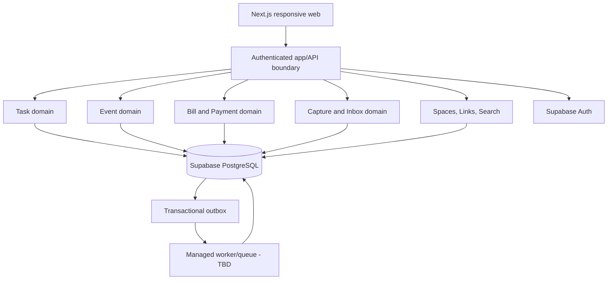

# LifeHub — Technology Stack Decision v1.1

> Status: **Proposed — review required**  
> Date: 2026-10-20  
> Scope: Decision record only; **no application code**.  
> Parent: Architecture Specification v1.0; Context-first Hybrid Life OS.

## Decision summary

**Recommended MVP stack:** Next.js App Router + TypeScript, Tailwind CSS + shadcn/ui/Radix, React Hook Form + Zod, Supabase managed PostgreSQL and Auth, Drizzle ORM, Vercel hosting, PostgreSQL full-text search, Vitest + Playwright, GitHub Actions. Managed worker/queue and monitoring vendors **remain open**.

Use a **modular monolith**, not microservices. Next.js route handlers/server actions are transport boundaries, not containers for domain logic. Keep application/domain services separate from presentation and persistence.

## Evaluation criteria
1. Delivery speed for small team (high)
2. Correctness of relational and recurring financial data (high)
3. Security, tenant isolation, authentication (high)
4. Managed-cloud operations and reasonable initial cost (high)
5. Ability to grow into integration-ready architecture (medium)
6. Hiring/maintenance ecosystem and TypeScript consistency (medium)
7. Advanced AI capability (low for MVP)

## Alternatives
| Option | Strengths | Risks/trade-offs | Decision |
|---|---|---|---|
| Next.js + Supabase PostgreSQL | Single TS stack, managed auth/DB, fast iteration | Must isolate domain logic, manage workers carefully | **Recommend** |
| Next.js + NestJS + PostgreSQL | Explicit backend modularity | More services/deployments and operational complexity | Defer |
| React + FastAPI + PostgreSQL | Strong Python ecosystem | Two languages, separate API lifecycle | Defer |
| React + Firebase | Rapid realtime prototyping | Document-oriented modeling less natural for complex bill/payment relations | Not selected |

These are architecture judgments, not vendor benchmarks.

## Stack selection matrix
| Layer | Candidate | Decision status |
|---|---|---|
| Language | TypeScript strict | Proposed |
| Frontend | Next.js App Router | Proposed |
| UI | Tailwind CSS + shadcn/ui + Radix | Proposed |
| Forms | React Hook Form + Zod | Proposed |
| Client server-state | TanStack Query only where useful | Proposed |
| DB | Supabase managed PostgreSQL | Proposed |
| ORM/migrations | Drizzle | Proposed |
| Auth | Supabase Auth | Proposed |
| Hosting | Vercel | Proposed |
| Async | Managed queue/worker + transactional outbox | Vendor open |
| Search | PostgreSQL full-text initially | Proposed |
| Unit/integration tests | Vitest | Proposed |
| E2E | Playwright | Proposed |
| CI | GitHub Actions | Proposed |
| Observability | Sentry or comparable | Open |
| External integrations | Adapters post-MVP | Deferred |

## Runtime architecture

Today/Upcoming are query projections over canonical Task, Event, Bill and Reminder data. They do not own independent copies. Domain boundaries must remain framework-agnostic where practical.

## Key implementation contracts (future engineering)
- Authenticated and tenant-scoped server-side queries/mutations; never trust client-supplied user_id.
- Prefer least-privilege DB credentials; no service-role secrets in browser. PostgreSQL RLS as defense in depth, with explicit server-side authorization.
- Drizzle transactions for payment creation, occurrence status and Inbox conversion.
- Idempotency keys for payment/capture and reminder delivery.
- PostgreSQL constraints for unique occurrence keys, same-user relationships and valid monetary values.
- Store times in UTC and IANA timezones for recurring schedules; clarify monthly short-month rule.
- Search remains tenant-scoped; read-after-write UI updates/refetches affected contextual projections.
- No optimistic paid status before server-confirmed transaction.
- For async tasks use durable outbox and at-least-once-safe workers; Vercel request handlers alone are not the durable reminder scheduler.

## Hosting and environments
- Local: isolated development DB.
- Preview: Vercel Preview + safe test data; **do not** expose production credentials to untrusted PR builds.
- Staging: separate managed DB/Auth and secrets.
- Production: managed Vercel + Supabase project.
- Monitoring: request errors/latency, DB health, outbox lag, reminder failures, auth anomalies.
- Backups and restore drills required before beta.

## Cost strategy
No hard-coded pricing in this ADR; vendor rates, plan limitations and free-tier allowances change. Establish workload assumptions (DAU/MAU, reads, writes, DB size, reminder volume, storage, preview builds), compare current vendor price sheets, and set monthly cost alerts. Avoid Redis/Elasticsearch/Kubernetes or separate API hosting until proven necessary. Separate staging/production data even if that adds some fixed cost.

## Risk register
| Risk | Mitigation |
|---|---|
| Next.js handlers become business-logic monolith | Explicit domain/application services and architecture tests |
| RLS/authorization gaps | Tenant isolation tests, server ownership checks, least-privilege credentials |
| Recurrence complexity | Dedicated occurrence model and timezone/short-month tests |
| Duplicate payment on retry | Transaction + unique idempotency key |
| Reminder worker reliability | Durable outbox, retry, dead-letter/alerts |
| Vendor coupling | Adapter interfaces for Auth, queue, integration; DB ownership explicit |
| Cost surprises | Budget alerts, workload modeling, review before scale |
| Search consistency | Index/projection update policy and read-after-write UX |

## Acceptance criteria
- **STACK-01:** Frontend/backend boundaries documented and TypeScript-first.
- **STACK-02:** Managed PostgreSQL is authoritative for native domain data.
- **STACK-03:** Auth/authorization and tenant isolation are designed independently of UI.
- **STACK-04:** Payment and Inbox conversion use transactional, idempotent writes.
- **STACK-05:** Worker architecture supports durable reminders; vendor choice remains explicit.
- **STACK-06:** Today/Upcoming reference canonical domain objects.
- **STACK-07:** Search is tenant-scoped and does not require separate search infrastructure at MVP.
- **STACK-08:** Preview, staging and production credentials/data are isolated.
- **STACK-09:** Tests cover domain logic, cross-user access, recurrence and critical E2E flows.
- **STACK-10:** Cost ceiling, vendor terms and deployment plan reviewed before coding.
- **STACK-11:** No nonessential infrastructure introduced without measured need.
- **STACK-12:** External integrations are optional and use adapters with source labeling.

## Open decisions before implementation
1. Cloud cost ceiling and expected beta users.
2. Queue/worker provider and reminder delivery channel.
3. Session design and Auth provider constraints.
4. Drizzle/Supabase connection pooling, migrations and backup/restore policy.
5. Bill partial-payment and recurrence semantics.
6. Hosting regions, data retention and Indonesian privacy compliance review.
7. Observability vendor and incident response baseline.

## Decision status
**Proposed, not approved for implementation.** Review with product owner and confirm workload/cost assumptions. No application code should be introduced in this PR.
