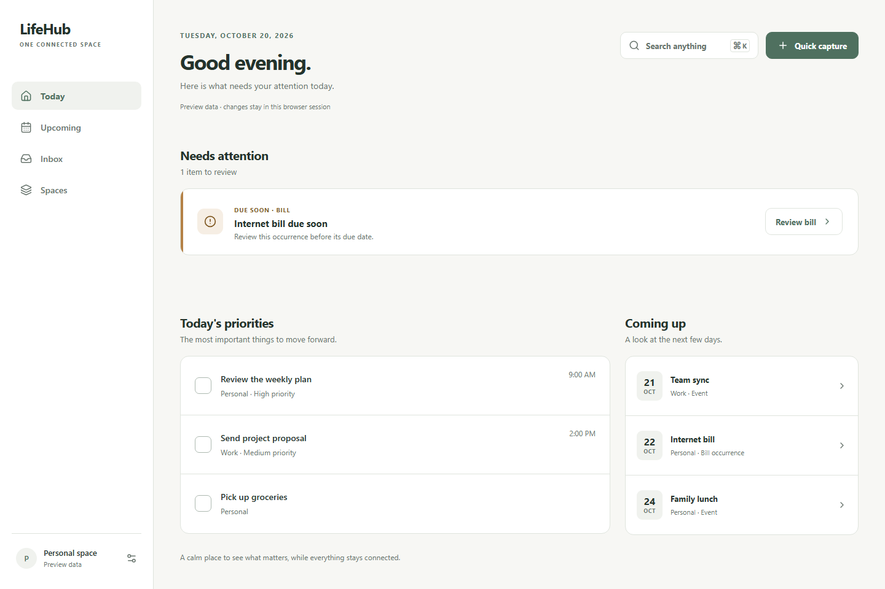
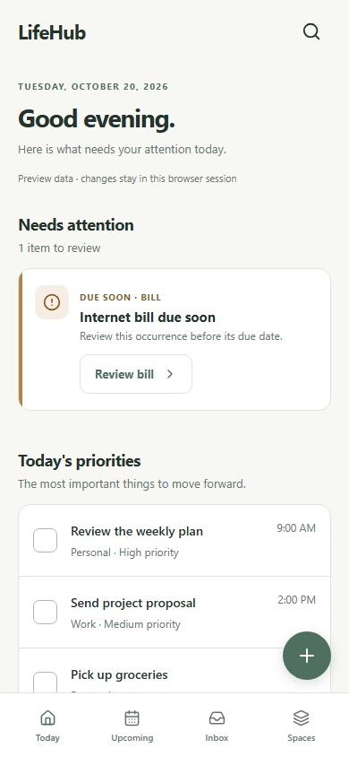

# Today Dashboard implementation review

## Screenshots

| Desktop 1440 × 960 | Mobile 390 × 844 |
| --- | --- |
|  |  |

Run `npm run build`, `npm run start`, then `npm test` to regenerate both images with the opt-in `?demo=1` fixture. The fixture is never used for the default Today route.

## Figma comparison

The linked Figma file (`MKTPGPF6l5EvVtpIZQfGQk`) currently exposes only `00 — Foundations & Components` and its `Foundations v1.0` frame. The desktop and mobile Today frames described in the implementation guide were unavailable. Colors and typography were checked against that foundation frame. Layout was checked against the guide's documented 250px sidebar, approximately 42px desktop gutter, 700/380px task/preview split, and 390px single-column mobile composition. A pixel comparison to the missing Today frames remains open for design review.

The mobile floating Capture button sits above the safe-area-aware tab bar. The content region has bottom padding so the final Coming Up row remains reachable. The button may float over card background during scrolling; it does not cover task text or tab controls at 390px in the captured state.

## Verification

- Production build and TypeScript check: pass.
- Browser check at 320, 375, 390, 768, 1024, and 1440px: no horizontal overflow.
- Four primary navigation links, conditional Needs Attention, empty and error states, Search, task toggle, and Capture review → preview Inbox: pass.
- Capture/tab geometry at 390px: no overlap.
- Color contrast calculated using WCAG relative luminance: primary text on canvas 12.34:1; secondary text on canvas 4.54:1; secondary on white 4.88:1; primary on white 5.50:1; attention text on pale amber 5.42:1. This is a palette check, not a full WCAG 2.2 audit.

## Scope and open decisions

This repository contained documentation only. The Today page uses typed Task/Event/Bill references and canonical detail URLs. The default route shows an explicit unavailable state until authenticated domain APIs exist. `?demo=1` enables isolated preview data and session-only interactions; it is not production persistence. Upcoming, Spaces, and canonical detail behavior remain outside this PR's screen scope. Search and Capture are functional within preview data; production actions wait for canonical APIs.

Design review is needed for the missing Today frames, mobile Capture placement, final copy/localization, and the full accessibility audit before merge.
