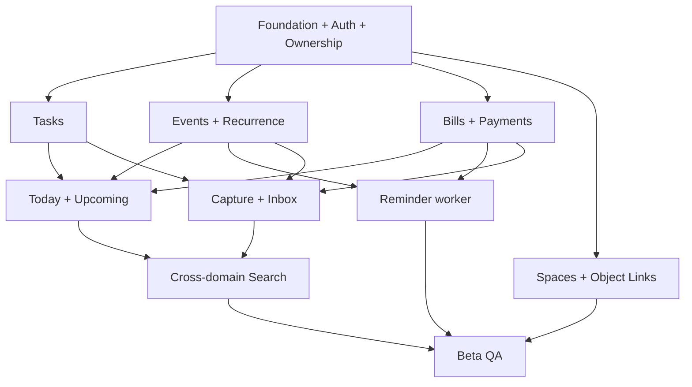

# LifeHub — MVP Engineering Backlog v1.0

> **Status:** Proposed / awaiting product-owner review  
> **Target:** Closed beta, approximately **50–500 users** (planning assumption, not concurrent users)  
> **Date:** 2026-10-20  
> **Scope:** Planning documentation only — **NO APPLICATION CODE**  
> **Sources:** Product Vision, UX IA v1.0, Wireframes v1.1, Interaction v1.2, High-Fidelity v1.3, UI Polish v1.4, Architecture v1.0, Technology Stack v1.1.

## Goals and non-goals

**Goal:** Deliver a secure, usable Context-first Hybrid Life OS for a limited beta. Users capture a Task, Event or recurring Bill once, find it through Today/Upcoming/Search/Spaces, and safely act without duplicating data.

**MVP:** Identity, preferences, Tasks, Today, Upcoming, Events, recurrence, Bills, per-occurrence payments, Spaces, Object Links, Inbox, Quick Capture, cross-domain Search, in-app reminders, beta operations.

**Not MVP:** external calendar sync, native mobile apps, advanced AI parsing, multi-user household sharing, full accounting, partial/multi-payment flows without a separately approved policy, analytics-heavy dashboard.

**Stack baseline (proposed):** Next.js App Router, TypeScript, Tailwind/shadcn, React Hook Form/Zod, Drizzle, Supabase PostgreSQL/Auth, Vercel, PostgreSQL full-text, Vitest/Playwright, GitHub Actions. Managed worker/queue vendor TBD. Do not treat open vendor decisions as finalized.

## Planning assumptions

- Six **two-week planning sprints**, subject to team capacity and discovery. **Not a delivery commitment.**
- Beta population 50–500 registered users; DAU, concurrency, traffic, reminder volume, and budget not yet established.
- One product owner approves acceptance criteria; QA/security review required for financial and user data flows.
- P0 = beta blocker, P1 = valuable if capacity permits, P2 = post-MVP.
- Story estimates below are **relative complexity** (S=1–2, M=3–5, L=8, XL=needs split), not person-days.

## Epics and backlog

| Epic | Name | Priority | Sprint focus |
|---|---|---|---|
| E01 | Platform Foundation | P0 | 1 |
| E02 | Identity & Security | P0 | 1 + ongoing |
| E03 | Tasks | P0 | 2 |
| E04 | Today & Upcoming | P0 | 2–4 |
| E05 | Events & Recurrence | P0 | 3 |
| E06 | Bills & Payments | P0 | 4 |
| E07 | Spaces & Object Relations | P0 | 4 |
| E08 | Inbox & Quick Capture | P0 | 5 |
| E09 | Search | P0 | 5 |
| E10 | Reminders & Notifications | P0 | 3–5 |
| E11 | Quality, Privacy & Beta Release | P0 | 1–6 |
| E12 | External Integrations | P2 | post-MVP |

### Sprint 1 — Foundation & Identity
**Goal:** secure, deployable application foundation; no product UI beyond essential auth/navigation scaffolding.

| ID | Story / deliverable | Priority | Size | Dependencies | Acceptance criteria |
|---|---|---|---|---|---|
| LH-001 | Initialize TypeScript modular-monolith project and domain boundary conventions | P0 | M | — | Documented module ownership; domain services separate from route/UI |
| LH-002 | Configure dev, preview, staging, production and secrets separation | P0 | M | LH-001 | Production secrets inaccessible to preview builds; environment matrix reviewed |
| LH-003 | Managed Auth sign-up/login/logout/session recovery | P0 | L | LH-001, LH-002 | Protected routes; expired session recovery; no auth token in logs |
| LH-004 | User profile, locale and IANA timezone preferences | P0 | S | LH-003 | User-specific preferences persist; id-ID supported |
| LH-005 | Database schema/migrations baseline, owner IDs and constraints | P0 | L | LH-001 | Reviewed migrations; ownership indexes and referential invariants |
| LH-006 | Authorization middleware and cross-user isolation tests | P0 | L | LH-003, LH-005 | User A cannot read/write User B's records, including via IDs |
| LH-007 | CI quality gates and initial unit/integration/E2E harness | P0 | M | LH-001 | Automated checks on PR; test DB isolated |
| LH-008 | Define API error format, request IDs, idempotency pattern | P0 | M | LH-001 | Structured validation/error codes; retry semantics documented |

**Exit:** auth flow works in staging; authorization tests pass; migrations and CI reproducible.

### Sprint 2 — Tasks & Today
| ID | Story | Priority | Size | Dependencies | Acceptance criteria |
|---|---|---|---|---|---|
| LH-009 | Task CRUD, validation and optimistic concurrency | P0 | L | LH-005, LH-006 | Canonical task ID; safe update/conflict behavior |
| LH-010 | Complete/reopen task with Undo and failure rollback | P0 | M | LH-009 | State reflects persisted result; Undo works |
| LH-011 | Today action-first read model and contextual sorting | P0 | L | LH-009 | Conditional Needs Attention; priorities above statistics |
| LH-012 | Canonical Task Detail and origin-preserving navigation | P0 | M | LH-009 | Back restores origin/filter/scroll where feasible |
| LH-013 | Responsive navigation shell and calm-light component primitives | P0 | L | LH-001 | Four tabs mobile, sidebar desktop, keyboard focus |
| LH-014 | Task/Today unit, authorization and E2E tests | P0 | M | LH-009–013 | No cross-user access; completion reflected in Today |

**Exit:** create task → see Today → complete → reopen → navigate back consistently.

### Sprint 3 — Events, Recurrence & Reminders Foundation
| ID | Story | Priority | Size | Dependencies | Acceptance criteria |
|---|---|---|---|---|---|
| LH-015 | Event CRUD with timezone and all-day semantics | P0 | L | LH-005, LH-006 | UTC storage + IANA timezone, valid start/end |
| LH-016 | Recurrence engine and stable occurrence keys | P0 | L | LH-015 | Monthly 29–31 rule explicit; DST edge cases tested |
| LH-017 | Edit occurrence / this-and-future / entire series | P0 | L | LH-016 | History preserved; scope confirmation shown |
| LH-018 | Upcoming date-grouped unified agenda foundation | P0 | L | LH-009, LH-015 | Task/Event date filters; origin date retained |
| LH-019 | Reminder rules and durable outbox design | P0 | L | LH-005, LH-016 | Durable enqueue, idempotent worker contract |
| LH-020 | In-app notification delivery and deduplication | P0 | L | LH-019 | No duplicate for same rule/occurrence/channel; retry-safe |
| LH-021 | Recurrence/reminder tests and worker failure simulations | P0 | L | LH-016–020 | Short-month/timezone/retry tests pass |

**Exit:** event recurrence edit is safe; reminder worker operates in staging. Worker vendor must be selected before implementation.

### Sprint 4 — Bills, Payments & Connected Objects
| ID | Story | Priority | Size | Dependencies | Acceptance criteria |
|---|---|---|---|---|---|
| LH-022 | Bill series and occurrence schema/creation | P0 | L | LH-005, LH-016 | Unique occurrence per series/key; recurrence visible |
| LH-023 | Occurrence-level payment transaction with idempotency | P0 | L | LH-022, LH-008 | One retry key → one payment; other months remain unpaid |
| LH-024 | Bill Detail, status and immutable/audited history | P0 | L | LH-023 | Current occurrence separated from series and history |
| LH-025 | Spaces CRUD and safe memberships | P0 | M | LH-005, LH-006 | Delete Space does not delete objects |
| LH-026 | Tenant-safe typed Object Links | P0 | L | LH-005, LH-006 | No cross-user links; links do not duplicate objects |
| LH-027 | Include Bills in Today/Upcoming projections | P0 | M | LH-011, LH-018, LH-022 | One canonical bill occurrence reflected across views |
| LH-028 | Payment/recurrence security and concurrency tests | P0 | L | LH-022–027 | Double-submit, race, ownership, historic payment tests |

**Exit:** recurring Bill can be paid for one month, linked to Space, found in Today/Upcoming without duplication.

### Sprint 5 — Quick Capture, Inbox & Search
| ID | Story | Priority | Size | Dependencies | Acceptance criteria |
|---|---|---|---|---|---|
| LH-029 | Capture input, deterministic interpretation and structured fallback | P0 | L | LH-009, LH-015, LH-022 | No silent assumption for ambiguous amount/date/recurrence |
| LH-030 | Editable Review, validation, save/retry, dirty draft guard | P0 | L | LH-029, LH-008 | No false success; failed save retains draft |
| LH-031 | Inbox unprocessed item lifecycle and atomic conversion | P0 | L | LH-029, LH-005 | Convert once; failure keeps item in Inbox |
| LH-032 | PostgreSQL full-text cross-domain search | P0 | L | LH-009, LH-015, LH-022 | Tenant-scoped; type/status/context shown |
| LH-033 | Search state and navigation preservation | P0 | M | LH-032 | Query/filter retained after detail |
| LH-034 | Contextual propagation, outbox projection reliability | P0 | L | LH-019, LH-027, LH-032 | Stale projection eventually reconciles; no duplicate records |
| LH-035 | End-to-end capture/bill/search/inbox scenarios | P0 | L | LH-029–034 | All ten critical usability scenarios exercised |

**Exit:** natural/structured Capture → editable Review → save or Inbox → Search/Today/Upcoming works.

### Sprint 6 — Hardening & Closed Beta
| ID | Story | Priority | Size | Dependencies | Acceptance criteria |
|---|---|---|---|---|---|
| LH-036 | WCAG 2.2 AA audit and keyboard/mobile fixes | P0 | L | UI flows | No critical accessibility blockers |
| LH-037 | Security/privacy review, authorization regression and log redaction | P0 | L | All domains | No cross-user leaks; sensitive fields absent from logs |
| LH-038 | Observability, alerting, worker failure/dead-letter handling | P0 | M | LH-019 | Detect API errors, outbox lag, failed reminders |
| LH-039 | Backup/restore drill and data export/deletion policy | P0 | L | LH-005 | Successful restore drill; approved retention/deletion flow |
| LH-040 | Load/cost test for 50–500 beta users with measured assumptions | P0 | M | Integrated staging | Agreed p95/queue lag and budget guardrails met |
| LH-041 | Regression E2E and closed-beta release checklist | P0 | L | All | Critical flows pass; release rollback documented |
| LH-042 | Closed beta onboarding, feedback and incident triage | P0 | M | LH-041 | Invite-controlled access, issue intake and rollback owner |

**Exit:** product owner signs off critical flows, security, restore, accessibility and operations before inviting testers.

## Cross-cutting dependency map

**Important:** recurrence, tenant isolation and payment semantics should be prototyped/tested early; the sprint order does not prohibit discovery spikes in Sprint 1–2.

## Definition of Ready
- Story has user value, owner, priority, dependencies and testable acceptance criteria.
- Domain ownership and data migration implications are understood.
- UI states (empty/loading/error/success) are specified where applicable.
- Security and authorization checks are listed.
- Unknown policy decisions are resolved or story explicitly marked blocked.

## Definition of Done
- Acceptance criteria pass in staging.
- Unit/integration/E2E coverage appropriate to risk.
- Server-side validation and authorization implemented and tested.
- Error, loading, empty and success states match UX specs.
- Retries and concurrency cannot create duplicate payment/conversion.
- Database migrations and rollback implications reviewed.
- No secrets or sensitive user data in logs.
- Accessibility and responsive states reviewed.
- PR reviewed, documentation updated, and observability considered.

## Closed-beta release gates
1. Account/session security and tenant isolation tests pass.
2. Critical flows: Task, Event recurrence, Bill payment, Capture/Inbox conversion, Search and Reminder all pass.
3. Zero known critical data-loss, cross-user access or duplicate-payment defects.
4. Backup/restore verified, audit logging and deletion/export policy reviewed.
5. Accessibility blockers resolved, mobile keyboard flows usable.
6. Staging load test reflects 50–500 registered beta users; concurrency and reminder assumptions explicitly documented.
7. Error/queue/worker monitoring, alert ownership, incident response and rollback are ready.
8. Product owner explicitly approves beta release.

## Risks and mitigations
| Risk | Mitigation |
|---|---|
| Sprint 3 recurrence underestimated | Early spike, occurrence invariants, property tests |
| Payment duplicate/incorrect occurrence | Transaction + unique idempotency key + audit |
| Cross-user data access | Negative authorization tests on all domains |
| Worker provider not selected | Architecture decision before LH-019 |
| Search projection stale | Outbox reconciliation + read-after-write UX |
| Feature creep | Enforce P0 scope; defer P1/P2 |
| 12-week target unrealistic | Re-estimate after Sprint 1; cut scope only through explicit product decision |
| Unexpected hosting cost | Measure beta load, budget alerts and usage review |

## Open decisions
- Team size/capacity and engineering owner for each epic.
- Budget ceiling, worker provider, hosting region and reminder precision.
- Recurrence short-month behavior, partial-payment policy.
- Data retention/export/deletion compliance review.
- Beta invite process and feedback channel.

## Traceability
- UX IA v1.0: navigation, Today/Upcoming, canonical routes.
- Interaction v1.2: INT-01–18, recurrence scope, Inbox atomicity.
- UI Polish v1.4: POL-01–10.
- Architecture v1.0: ARC-01–15.
- Stack v1.1: STACK-01–12.

**This PR is planning-only.** Creating engineering issues or starting implementation should be a separate approved action.
